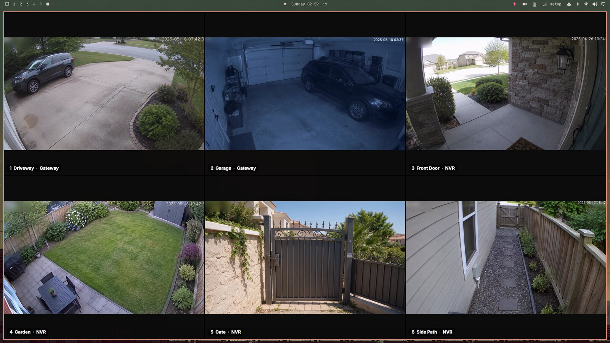
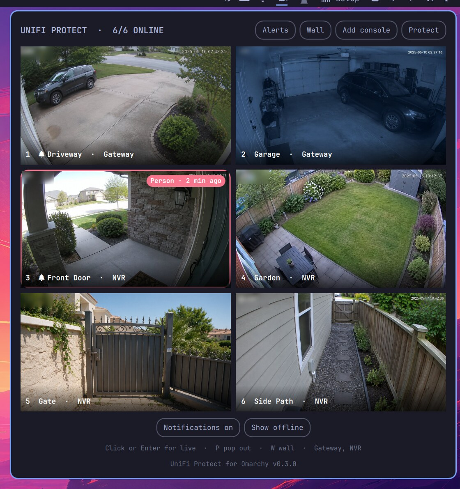
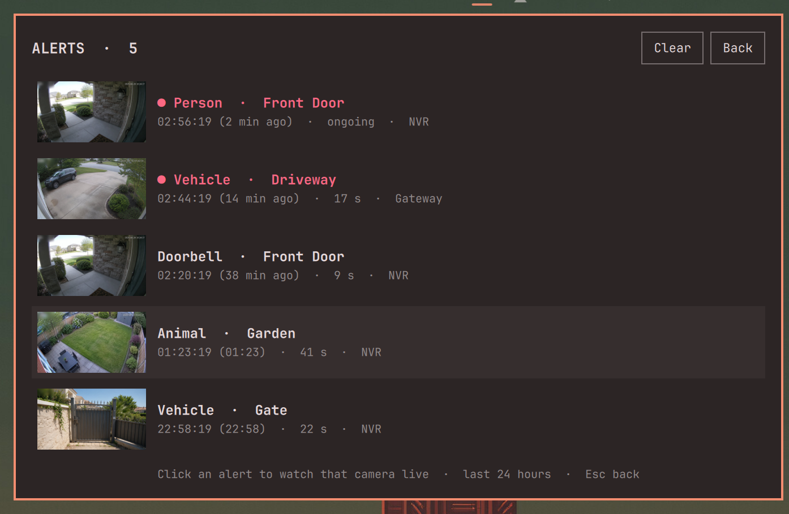
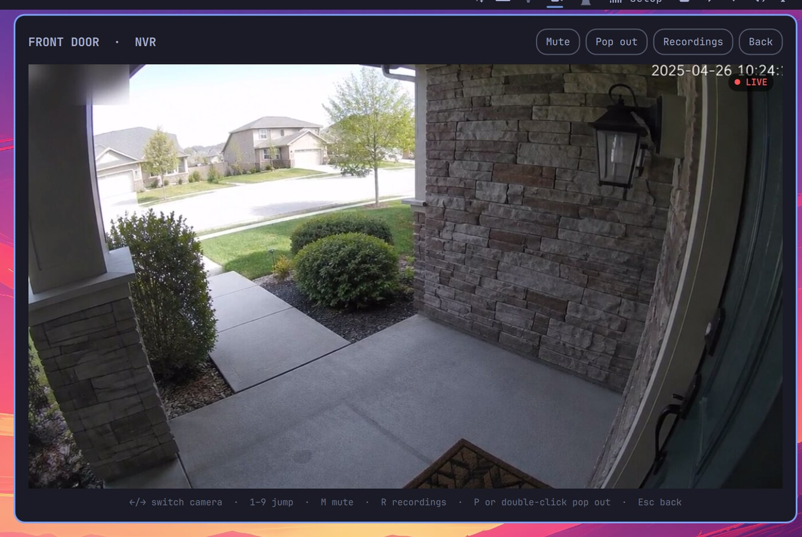
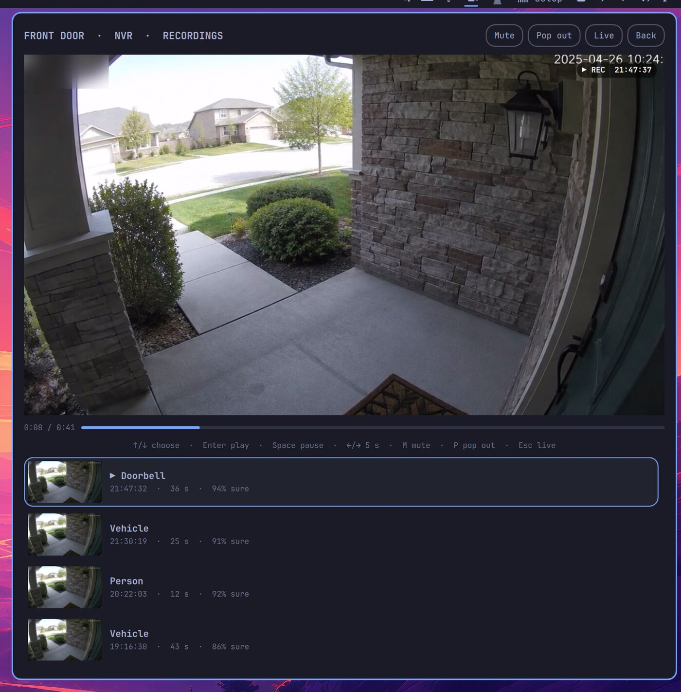

# UniFi Protect for Omarchy

Your UniFi Protect cameras in the Omarchy bar: a grid of auto-refreshing
snapshots, live video with sound right in the panel, a camera wall with every
camera live at once, and a pop-out player. Works with several consoles at
once, such as a gateway and a dedicated NVR, and is set up from the panel
itself. Arm a camera to be alerted when it sees a person, a vehicle or a
doorbell ring, and play back what each camera recorded. Video travels
encrypted, and API keys are kept in your keyring (or a file only you can
read).

In the bar it is a single camera icon. It pulses in your theme's urgent
colour when an armed camera has seen something, turns that colour when a
camera is offline, and gets a small dot when a console could not be reached
on the last poll.

Version 0.4.1 · [Changelog](CHANGELOG.md) · MIT licensed · by ELD Technologies



*The camera pictures in these screenshots are AI-generated for demo purposes; they show no real place or person. The screenshots themselves are of the real plugin, running in [demo mode](#developing).*

> **Unofficial.** This is an independent community plugin. It is not made,
> endorsed, or supported by Ubiquiti Inc. or by the Omarchy project.

## Screenshots

| Camera grid | Alert log |
|---|---|
|  |  |

| Live view | Recordings |
|---|---|
|  |  |

*The camera pictures in these screenshots are AI-generated for demo purposes; they show no real place or person. The screenshots themselves are of the real plugin, running in [demo mode](#developing).*

## Requirements

- Omarchy with the Quickshell-based Omarchy shell
- A UniFi console running **UniFi Protect 5.3 or newer** (for the official
  Integration API): Dream Machine, Cloud Gateway, UNVR, and so on
- `python3` (ships with Omarchy; the helper uses the standard library only)
- `secret-tool` from `libsecret` and a keyring such as `gnome-keyring` (both
  ship with Omarchy) to keep API keys in the keyring; optional, see below
- `qt6-multimedia-ffmpeg` for live video (ships with Omarchy)
- `mpv`, optional, for the pop-out player and recorded clips in their own
  window: `omarchy pkg add mpv`
- For [recordings](#recordings), optional: a local UniFi account on each
  console that records
- A notification daemon, such as the one that ships with Omarchy, for alert
  notifications

## Install

```bash
omarchy plugin add https://github.com/eldtechnologies/omarchy-plugin-unifi-protect --enable
```

Then click the camera icon in the bar and choose **Run setup**.

Or install from a checkout. This also puts the `eld-unifi-protect` command on
your `PATH`:

```bash
git clone https://github.com/eldtechnologies/omarchy-plugin-unifi-protect
cd omarchy-plugin-unifi-protect
./install.sh
eld-unifi-protect setup
```

### Connecting a console

Setup runs inside the panel (**Run setup**, or **Add console** later); the
same steps are available in a terminal with `eld-unifi-protect setup`. It asks
for the console's address, shows the fingerprint of its TLS certificate for
you to confirm, then asks for an API key. Pinning trusts the certificate
the console presents the first time, so do this on a network you trust. A
browser on the same network sees the same certificate, so comparing there
only catches mistakes, not an attacker in the path; for an independent
check, read the fingerprint on the console itself, for example over SSH
with `openssl x509 -noout -fingerprint -sha256` on its certificate. In the
panel, the key goes from a
password field to the helper on stdin and the field is cleared at once; it
never reaches a log or a command line. It is kept in your keyring, or, when
no keyring is available, in a file only you can read (see below).

Give the plugin the least it needs: an API key from an account with only
the access you want it to have, and for recordings a local view-only
account.

Create the key **on the console itself**; this is the route known to work:

1. Open `https://<console-ip>` and sign in.
2. Click **Integrations** at the bottom of the left sidebar. On older UniFi OS
   it is under Settings: scroll the row of tabs sideways.
3. **Create API Key** and copy it. It is shown only once.

Paste it with **Super + V**. The key field (or the terminal prompt) is hidden
like a password, so nothing visible appears as you paste.

UniFi Site Manager (unifi.ui.com) can also create API keys. Reports differ on
whether a console's local API accepts those, so if setup says the key was
rejected (HTTP 401), create one on the console as above instead.

### Several consoles

Each UniFi console runs its own Protect with its own API key; a gateway's key
does not work on an NVR. Run setup once per console, or click **Add console**
in the panel. All cameras land in one grid, labelled with their console.

A camera moved from one console to another stays listed on the old one as
disconnected. Cameras are matched by MAC address and the connected copy wins,
so these leftovers never hide a live camera.

```bash
eld-unifi-protect consoles          # list them
eld-unifi-protect setup             # same address + empty key = just rename it
eld-unifi-protect remove nvr
```

## Using it

### Bar and panel

| Where | Action | Effect |
|-------|--------|--------|
| Bar | Left click | Open the panel |
| Bar | Middle click | Refresh |
| Bar | Right click | Open Protect in the browser |
| Grid | Click / Enter | Live view in the panel |
| Grid | Arrows / hjkl | Move the selection |
| Grid | `1`–`9` | Live view of camera N |
| Grid | `W` | Camera wall |
| Grid | Hover a tile | Bell to arm alerts, ★ favourite, eye to hide, pop-out button |
| Grid / live | `P` | Pop out to mpv |
| Live | ← / → | Previous / next camera |
| Live | `M` | Mute / unmute |
| Live | `R` | Recordings of this camera |
| Live | Double-click | Pop out |
| Live | Esc | Back to the grid |
| Recordings | ↑ / ↓, Enter | Choose a detection, play it |
| Recordings | Space, ← / → | Pause, seek 5 s |
| Recordings | `P` | The clip in mpv, seekable |
| Recordings | Esc | Back to live (or to the alert log) |
| Grid | `A` | Alert log |
| Panel footer | Click the version | Release notes for that version |

### Sound

Sound plays whenever exactly one camera is on screen: the panel's live view,
a recording playing back, an enlarged camera on the wall, and the pop-out
player. It goes to your system's default output and follows it, so
headphones connected after login are picked up. The grid and the
wall's tiles are always silent (they don't even decode audio). `M` mutes;
the choice carries over while you flip between cameras, and opening a camera
from the grid again starts with sound. Set `sound` to `false` to start
muted instead. Cameras with the microphone turned off in Protect have no
sound to play.

### Camera wall

**Wall** in the panel header, or `W`, shows every visible camera live. Click
a camera or press `1`–`9` to enlarge it at high quality. ←/→ flips cameras,
`M` mutes, Esc goes back to the grid, and Esc (or `Q`) again closes
the wall. Streams that drop reconnect on their own.

It opens in one of two modes, set with `wallMode`:

- **`window`** (default): a maximized window. It keeps the bar visible and
  stays on its workspace, so Super+number switches away and back while the
  cameras keep running. On Hyprland the plugin registers a runtime rule that
  maximizes only this window (matched by its title, "UniFi Protect Wall"); it
  writes nothing to your config.
- **`overlay`**: covers the whole screen, above every workspace, and holds the
  keyboard until you close it. Good for a dedicated monitoring screen.

`eld-unifi-protect wall --mode overlay` picks a mode for one launch.

The wall runs as its own Quickshell process, not inside the Omarchy shell, so
a video decoder fault can never take down the bar or the lock screen.

### Favourite camera

Hover a tile and click the star to make it your favourite. It moves to the
front of the grid and is selected whenever the panel opens; with
`openFavoriteLive` the panel opens straight into its live view. Like hiding,
it follows the camera by MAC address.

```bash
eld-unifi-protect favorite "Front Door"
eld-unifi-protect favorite --clear
```

### Hiding cameras

Hover a tile and click the crossed-out eye to hide that camera. **Hide
offline** hides every camera that is not connected. Hidden cameras leave the
grid, the wall, and the bar's health colour; **Show hidden** brings them back
into view so you can unhide them. Hiding follows a camera by MAC address, so
it survives a move to another console.

```bash
eld-unifi-protect hide "G6 PTZ"
eld-unifi-protect unhide "G6 PTZ"     # or: unhide --all
eld-unifi-protect hide-offline on     # off / toggle
```

### Alerts

Hover a tile and click the bell to arm that camera. The plugin then listens
to the console's event stream for a **person**, a **vehicle** or a **doorbell
ring** (also available from the command line: `animal`, `package`, `motion`).

When an armed camera sees one, the **bar icon turns red and pulses** until you
open the panel. Its tooltip says what, where and when. In the panel, that
camera's tile is selected, with a red border and a badge such as "Person · 2
min ago" for ten minutes. Armed cameras carry a bell in their label. If a
console's event stream can't be reached, the panel says so.

**Alerts** in the panel header (or `A`) opens the alert log: what was seen,
on which camera, when and for how long, with a snapshot from that moment,
newest first. Alerts you hadn't seen yet are marked. Click one to watch its
[recording](#recordings) (or that camera live, without a recordings login); **Clear** empties the log, which otherwise keeps the last 24
hours. When you open the panel because the bar is pulsing, it goes straight
to the log.

Each alert also sends a **desktop notification**, "Person at Front Door",
with a snapshot from that moment and a **Watch live** button that opens the
panel on that camera. To avoid floods there is at most one notification per
camera per minute; every alert is still recorded, up to ten new ones per
camera per minute (more than that is treated as a flood and dropped). Turn
them off with
**Notifications on** in the panel footer, or
`eld-unifi-protect alert --notify off`. Notifications are marked transient,
but Omarchy's notification history still keeps the latest ones, with their
picture, under `~/.local/state/omarchy/notifications/` until you clear it.

```bash
eld-unifi-protect alert "Front Door"                  # person, vehicle, ring
eld-unifi-protect alert "Driveway" --on vehicle
eld-unifi-protect alert "Front Door" --off
eld-unifi-protect alert                               # armed cameras and recent alerts
eld-unifi-protect alert --clear                       # empty the alert log
```

Detection is done by Protect, so a camera needs smart detections enabled in
Protect for person and vehicle alerts. Alerts are a convenience, not a
security system: nothing is flagged while your computer is asleep or off.

### Recordings

**Recordings** in the live view header (or `R`) lists what that camera
detected in the last 24 hours: person, vehicle, animal, package, doorbell,
each with a thumbnail, the time, how long it lasted and how sure Protect was.
The newest starts playing right away. ↑/↓ and Enter play another, Space
pauses, ←/→ seeks 5 seconds, and the bar under the video seeks anywhere. A
**REC** badge with the time on screen replaces the LIVE one, so a recording
never passes for live video. `P` opens the clip in mpv at pop-out quality,
where you can zoom, pan and step through it. Clicking an alert in the alert
log plays its recording the same way.

Protect hands out recordings only to a signed-in user, never to an API key,
so this needs a **local UniFi account** on each console that records:

1. Open the console in a browser: **Admins & Users** → **Add**.
2. Tick **Restrict to local access only** (local accounts have no two-factor
   prompt), and give it a **view-only** Protect role. It needs nothing else.
3. Open a camera's recordings in the panel and sign in with it, or run
   `eld-unifi-protect login <console>`.

The password is kept like the API key: in your keyring, or in a file only you
can read when there is no keyring. `eld-unifi-protect logout <console>`
removes it. Clips are exported by Protect as MP4, padded by 3 seconds either
side and capped at 5 minutes. They are kept in memory (the runtime
directory), at most 25 clips or 600 MB, and are gone at logout, when the
console is removed, or at reboot.

```bash
eld-unifi-protect login nvr                       # username, password prompt
eld-unifi-protect recordings "Front Door"         # last 24 h: time, kind, length
eld-unifi-protect clip "Front Door" --start 1791811452 --end 1791811470 --play
eld-unifi-protect clip "Front Door" --start 1791811452 --end 1791811470 -o door.mp4
```

These are the endpoints Protect's own web app uses, not its published API.
Other tools, such as Home Assistant's UniFi Protect integration, rely on them
too, but a Protect update could change them; the rest of the plugin does not
depend on them.

### Keybindings and scripts

```bash
eld-unifi-protect wall                  # toggle the camera wall
omarchy-shell com.eldtechnologies.unifi-protect toggle
omarchy-shell com.eldtechnologies.unifi-protect live "Front Door"
omarchy-shell com.eldtechnologies.unifi-protect recordings "Front Door"
omarchy-shell com.eldtechnologies.unifi-protect alertStatus   # JSON: alerting, latest alert
eld-unifi-protect cameras               # list cameras and their ids
eld-unifi-protect live <camera-id>      # straight to mpv
```

For example, in `~/.config/hypr/bindings.lua`:

```lua
o.bind("SUPER + SHIFT + C", "Camera wall", "eld-unifi-protect wall")
o.bind("SUPER + SHIFT + ALT + C", "Camera wall (overlay)", "eld-unifi-protect wall --mode overlay")
```

### Pop-out player

`P` (or double-click in live view) opens the camera in its own mpv window at
high quality. Scroll to zoom in on a detail, horizontal scroll or
Ctrl+arrows to pan, and Ctrl+0 to reset; `m` mutes, `f` toggles fullscreen
and `q` closes it. If the stream drops, the window reconnects on its own.

The mpv window uses the app id `eld-unifi-protect`, for window rules.

## Configuration

Widget settings live in `~/.config/omarchy/shell.json` and reload on save:

| Key | Default | Meaning |
|-----|---------|---------|
| `refresh` | `balanced` | Snapshot refresh while the panel is open: `fast` (1 s), `balanced` (3 s), `efficient` (10 s). An explicit `snapshotIntervalSec` overrides it |
| `framing` | `fill` | `fill` crops pictures to the tile; `fit` shows the whole picture, letterboxed |
| `openFavoriteLive` | `false` | Open the panel straight into the favourite camera's live view |
| `columns` | `2` | Grid columns |
| `liveQuality` | `medium` | Stream for the in-panel live view |
| `popoutQuality` | `high` | Stream for the mpv window |
| `sound` | `true` | Sound when one camera is shown (live view, enlarged wall camera, pop-out); `false` starts muted |
| `wallMode` | `window` | Camera wall as a maximized `window` or a full-screen `overlay` |

```json
{ "id": "com.eldtechnologies.unifi-protect", "columns": 3, "liveQuality": "high" }
```

The plugin's own files:

| Path | Contents |
|------|----------|
| Desktop keyring (Secret Service) | API keys and recordings passwords, when a keyring is available |
| `~/.config/eld-unifi-protect/config.json` | Consoles, pinned certificates and recordings usernames; API keys and passwords only if there is no keyring (mode 0600) |
| `~/.config/eld-unifi-protect/cameras.json` | Hidden cameras, favourite, armed cameras, read-only setting (no secrets) |
| `~/.local/state/eld-unifi-protect/state.json` | Last camera list |
| `$XDG_RUNTIME_DIR/eld-unifi-protect/` | Snapshots, stream URLs, recent alerts and their pictures, recordings sessions, thumbnails and clips (tmpfs, gone on reboot; your notification history may keep its own copy of alert pictures) |
| `~/.local/state/eld-unifi-protect/` | Last camera list, rejected recordings logins, streams the plugin switched on |

## How it works

The Omarchy shell never speaks HTTP and never holds an API key: a key typed
into the panel goes straight to the helper on stdin. The helper
`bin/eld-unifi-protect` talks to the Protect Integration API
(`/proxy/protect/integration/v1`), writes camera state and snapshots to disk,
and resolves stream URLs. The panel watches those files and plays the
streams.

- **API keys** are stored in your desktop keyring (Secret Service, through
  `secret-tool`), encrypted at rest, whenever one is available; otherwise in
  `config.json`, readable only by you. They are passed to `secret-tool` on
  stdin, never as arguments. `eld-unifi-protect migrate-keys` moves existing
  keys into the keyring (`--to file` moves them back), and `doctor` shows
  where each console's key lives.
- **Recordings** use a separate sign-in, with a local UniFi account (see
  [Recordings](#recordings)), against the endpoints Protect's web app uses
  (`/proxy/protect/api`): one sign-in per console, kept for the session in
  the runtime directory (`sessions.json`, mode 0600). A rejected password is
  never tried again until you sign in again, since UniFi OS locks accounts
  after repeated failures.
  The password is stored and passed like the API key, on stdin only.
- **Traffic:** while the panel is closed, one camera-list poll per console per
  minute. Snapshots are fetched only while the panel is open on the grid.
  While a camera is armed, the helper also keeps one connection open to that
  console's event stream (`/subscribe/events`, same pinned TLS), plus one
  snapshot per alert.
- **TLS:** consoles use self-signed certificates. Setup pins each console's
  certificate fingerprint, and every API request checks it before the key is
  sent. If a console's certificate legitimately changes (firmware update,
  factory reset), run setup again for that console: it asks you to confirm
  the new certificate and to enter the API key again. `eld-unifi-protect
  trust-cert` re-pins without a new key, for a fingerprint you have checked
  on the console itself (`--pin <sha256>` re-pins only to that one); the
  stored key and recordings login are then sent to the new certificate.
- **Video is encrypted end to end on your network.** Protect serves video
  as RTSPS (port 7441) behind the same self-signed certificate. FFmpeg, inside
  both QtMultimedia and mpv, refuses unverified TLS and cannot be given the
  pinned certificate, so players connect to a small relay instead:

  ```
  player --plain RTSP, 127.0.0.1 only--> relay --TLS, pinned cert--> console:7441
  ```

  The relay checks the same pinned certificate as the API, forces all media
  over the encrypted TCP connection (it refuses UDP, and FFmpeg falls back),
  listens only on 127.0.0.1, and requires a random per-session token in every
  URL, and accepts connections only from your own user (it checks who owns
  the other end), so other local users cannot borrow it even if they see a
  URL, say in the system journal. Those URLs never contain the
  camera's Protect stream alias, only a random route id that the relay maps
  back privately, so nothing a player is given could be used against the
  console. The relay starts on demand and exits after a minute without
  viewers. The only unencrypted hop is loopback inside your machine.
- **Streams get switched on:** if a camera has no stream yet for the quality
  you open, the plugin enables one, the same as turning on RTSP in the
  camera's Protect settings. It stays enabled, including after you remove
  the plugin, and anyone on your network who learns that stream's address
  can watch it, as with any RTSPS stream Protect serves; turn it off in
  Protect (camera → Settings → Advanced) if you no longer want it. To
  forbid the plugin from switching streams on, turn on read-only mode:
  `eld-unifi-protect read-only on`. The plugin then never
  changes anything on your consoles. It uses only streams already enabled in
  Protect, falling back to the nearest enabled quality, and tells you how to
  enable one when a camera has none.
- **Rate limits:** requests that get HTTP 429 wait and retry, and stream URLs
  are cached for the session.

`eld-unifi-protect doctor` checks every console end to end.

### Performance

Video is decoded on the GPU (VA-API) by both QtMultimedia and mpv; the
helper only moves encrypted bytes. Measured on an Intel N100:

| Workload | CPU, share of one core |
|---|---|
| Wall, 6 cameras (720p tiles, GPU decode, no tile audio) | ~17% |
| Relay, TLS for those 6 streams | ~4–5% |
| One 4K stream, GPU decode | ~4% |
| One 4K stream, CPU decode (what mpv does without `--hwdec`) | ~35% |

The helper is Python on purpose: plugins install by `git clone` with no
build step, so readable source with no dependencies beats a compiled binary,
and the relay is not the bottleneck: it sustains over 2 Gbit/s on the same
machine, against roughly 30 Mbit/s for a busy wall.

## Removing it

If you installed with `omarchy plugin add`:

```bash
helper=~/.config/omarchy/plugins/com.eldtechnologies.unifi-protect/bin/eld-unifi-protect
"$helper" enabled-streams              # streams to turn off in Protect, if you want
"$helper" stop --sign-out              # stop it, sign out recordings sessions
omarchy plugin remove com.eldtechnologies.unifi-protect
rm -rf ~/.config/eld-unifi-protect ~/.local/state/eld-unifi-protect "$XDG_RUNTIME_DIR/eld-unifi-protect"
secret-tool clear service eld-unifi-protect
secret-tool clear service eld-unifi-protect-login
```

`omarchy plugin remove` deletes only the plugin folder, so the other lines
stop what is running, sign recordings sessions out on the consoles, and
delete your settings, API keys and recordings passwords. A locked keyring
keeps its items: check with `secret-tool search --all service
eld-unifi-protect`.

If you installed with `./install.sh`, run `./uninstall.sh` from the checkout.
It also removes the `eld-unifi-protect` command and asks whether to delete your
API keys and recordings passwords (`--purge` says yes, `--keep-config` says
no).

Either way, revoke the API keys on each console as well, and delete the local
recordings account if you made one: deleting the local copy does not revoke
them. Streams the plugin switched on stay on in Protect until you turn them
off, and your notification history may keep pictures of past alerts.

## Developing

`./install.sh --link` symlinks your checkout into the plugin directory. The
shell's file watcher does not follow that symlink, so after editing
`Panel.qml` or `BarWidget.qml`, run `omarchy restart shell`. Changes to
`bin/eld-unifi-protect` and `wall/shell.qml` take effect the next time they
run.

The version is set in `manifest.json` only; `eld-unifi-protect --version` reads
it from there. Record changes in `CHANGELOG.md`.

**Demo mode** shows made-up consoles and cameras instead of yours, for
screenshots, development, or trying the plugin without UniFi hardware:
`eld-unifi-protect demo on` (and `demo off`). Your config and camera
settings are never changed while it is on, your alert log, snapshots and
recordings are set aside and come back with `demo off`, and a reboot
always ends it. `tools/screenshots.sh [workspace]`
captures the README screenshots from the real UI on demo data, on an empty
workspace; see [docs/demo](docs/demo/README.md).

Run the tests (standard library only; they never touch your real config,
keys or consoles):

```bash
python3 -m unittest discover -s tests -v
```

They include end-to-end tests of the stream relay, and of the recordings
sign-in and clip export, against a fake TLS console. CI runs them, plus a
manifest check and `shellcheck`, on every pull request. To report a vulnerability, see [SECURITY.md](SECURITY.md).

## Disclaimer

This software is provided **as is, without warranty of any kind**, and ELD
Technologies accepts no liability for any damage or loss arising from its
use. See [LICENSE](LICENSE) for the full terms. In particular:

- It is not a security or monitoring system. Do not rely on it to record,
  detect, or alert on anything; use UniFi Protect itself for that. Alerts
  are missed while your computer is asleep, off, or offline.
- It stores console API keys, and the recordings password if you use
  recordings, on your machine (in your keyring, or in a file readable only by
  you) and can enable RTSPS streams on your cameras (unless read-only mode
  is on). You are responsible for deciding whether that is
  acceptable for your network.
- It uses UniFi Protect's Integration API, which Ubiquiti may change at any
  time. Recordings use the unpublished endpoints of Protect's own web app,
  which may change without notice.

UniFi, UniFi Protect and Ubiquiti are trademarks of Ubiquiti Inc. Omarchy
belongs to its authors. These names are used here only to describe what this
plugin works with.

## License

MIT © 2026 ELD Technologies. See [LICENSE](LICENSE).
